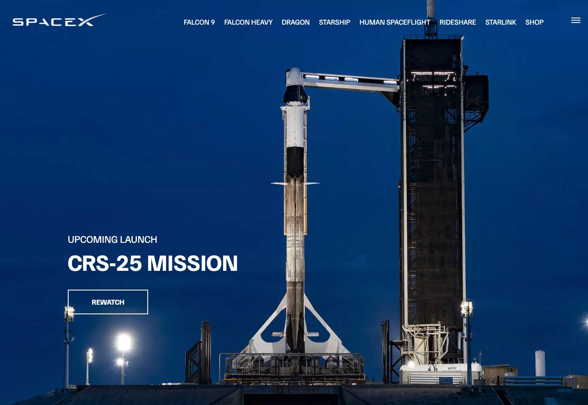

# SpaceX Website Clone

A clone of the SpaceX website built with plain HTML, CSS and JavaScript — no framework, no build
step.



## About

This is not the full site. It covers the homepage plus a few inner pages, rebuilt to practise
CSS animation and responsive layout without reaching for a library:

- Homepage with scroll-driven CSS animations
- Vehicle pages for Falcon 9, Falcon Heavy and Dragon
- Responsive mobile menu
- Countdown timer written in vanilla JavaScript

## Tech stack

- HTML
- CSS
- Vanilla JavaScript

## Pages

| File | Page |
| --- | --- |
| `index.html` | Homepage |
| `falcon9.html` | Falcon 9 |
| `falcon-heavy.html` | Falcon Heavy |
| `dragon.html` | Dragon |

## Running it locally

No dependencies and no build step. Clone the repository and open `index.html` in a browser.

```bash
git clone https://github.com/Brunomon2812/SpaceX.git
cd SpaceX
open index.html
```

## Author

Bruno Monteiro — [GitHub](https://github.com/Brunomon2812) · [LinkedIn](https://www.linkedin.com/in/brunoarmonteiro/)

---

This is a personal study project. SpaceX is a trademark of Space Exploration Technologies Corp.,
which is not affiliated with this repository.
